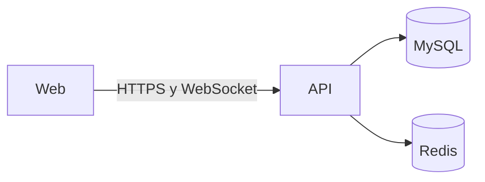

# Plantillas

Se copia la del tipo y se borra lo que no aplica. Norma de cada sección:
`tech/readme.md` y `tech/repository.md`.

## README de una aplicación con interfaz

````markdown
<p align="center">
  <picture>
    <source media="(prefers-color-scheme: dark)" srcset="public/marca/imagotipo-oscuro.svg">
    " src="public/marca/imagotipo-claro.svg" height="72">
  </picture>
</p>

<h1 align="center"><Producto> Web</h1>

<p align="center"><Qué hace y para quién, en una frase con verbo de menos de 120 caracteres.></p>

<p align="center">
  <a href="LICENSE"></a>
</p>

<picture>
  <source media="(prefers-color-scheme: dark)" srcset="docs/imagenes/inicio-oscuro.png">
  " src="docs/imagenes/inicio-claro.png">
</picture>

## Características

- <Lo que resuelve, en una línea.>

## Requisitos

| Herramienta | Versión |
| --- | --- |
| Docker Desktop | 4.40 o superior |

## Inicio rápido

```bash
cp .env.example .env
sh deploy/docker/desplegar.sh
```

La guía completa, en [docs/desarrollo.md](docs/desarrollo.md).

## Documentación

| Quiero… | Documento |
| --- | --- |
| Programar en mi PC | [desarrollo.md](docs/desarrollo.md) |

## Estructura

```text
src/        <una línea>
docs/       documentación
```

## Contribuir

Ramas cortas desde `main` y PR con la CI en verde; las pruebas, con
`<comando>`.

## Licencia

Copyright © <año> <titular>. Todos los derechos reservados.

Software propietario. Las condiciones de uso figuran en [LICENSE](LICENSE).
````

## README de una API o servicio

Igual que el de aplicación, con un diagrama en lugar de la captura:

````markdown

````

## README de una librería o CLI

- «Inicio rápido» lleva la instalación y el ejemplo mínimo con su salida.
- «Uso» lleva la tabla `Comando` \| `Para qué` (CLI) o lo que exporta
  (librería), o el enlace a su referencia.
- Insignias de versión publicada y de licencia, si es pública.

```markdown
## Inicio rápido

    npm install @abitechdev/<producto>

    import { convertir } from '@abitechdev/<producto>'
    convertir('coleccion.json') // → 'coleccion.postman.json'
```

## README de configuración o documentación

No lleva «Inicio rápido» de aplicación. «Uso» reúne los comandos que la
aplican y «Estructura» dice qué va en cada carpeta.

## LICENSE propietaria

```text
Copyright © <año> <titular>. Todos los derechos reservados.

Este software y su documentación son propiedad de <titular>. Queda
prohibido copiarlos, modificarlos, distribuirlos o usarlos, total o
parcialmente, sin autorización previa y por escrito del titular.
```

## CHANGELOG.md

```markdown
# Changelog

Cambios notables de <producto>, según Keep a Changelog 1.1 y SemVer 2.0.

## [Sin publicar]

### Añadido

- <Qué puede hacer ahora quien usa el sistema.>

## [0.1.0] - 2026-11-21

### Añadido

- <…>

[Sin publicar]: https://github.com/<dueño>/<repo>/compare/v0.1.0...HEAD
[0.1.0]: https://github.com/<dueño>/<repo>/releases/tag/v0.1.0
```

## SECURITY.md

```markdown
# Seguridad

## Reportar una vulnerabilidad

Escriba a <correo de seguridad> con los pasos para reproducirla. No abra
un *issue* público. La respuesta llega en un máximo de 3 días hábiles.

## Versiones con soporte

Solo la última versión publicada recibe correcciones.
```
