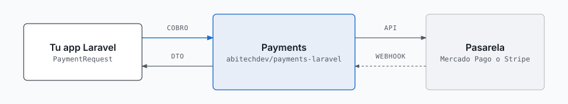

<p align="center">
  <picture>
    <source media="(prefers-color-scheme: dark)" srcset="docs/imagenes/logo-oscuro.svg">
    
  </picture>
</p>

<h1 align="center">Payments Laravel</h1>

<p align="center">Charge, refund, subscribe and receive Mercado Pago and Stripe webhooks in Laravel through one interface</p>

<p align="center">
  <a href="https://packagist.org/packages/abitechdev/payments-laravel"></a>
  <a href="https://github.com/abitech-dev/abitech-payments-laravel/actions/workflows/ci.yml"></a>
  
  <a href="LICENSE"></a>
</p>

<p align="center">
  <a href="#quick-start">Quick start</a> &nbsp;|&nbsp;
  <a href="#usage">Usage</a> &nbsp;|&nbsp;
  <a href="#documentation">Documentation</a> &nbsp;|&nbsp;
  <a href="README.md">Español</a>
</p>

<picture>
  <source media="(prefers-color-scheme: dark)" srcset="docs/diagramas/flujo-dark.svg">
  
</picture>

Your app builds a `PaymentRequest`, picks a driver and gets the same response
for Mercado Pago and Stripe. The package talks to the gateway and verifies its
webhooks; your app stores, deduplicates and decides.

## What it does

<table>
  <tr>
    <td width="50%" valign="top">
      <picture><source media="(prefers-color-scheme: dark)" srcset="docs/iconos/pasarelas-dark.svg"></picture><br><strong>One interface, two gateways</strong><br>Mercado Pago and Stripe return the same DTOs; switching gateways means switching the driver.
    </td>
    <td width="50%" valign="top">
      <picture><source media="(prefers-color-scheme: dark)" srcset="docs/iconos/webhook-dark.svg"></picture><br><strong>Verified webhooks</strong><br>With the secret set, every notification is validated and arrives as a <code>WebhookResult</code>.
    </td>
  </tr>
  <tr>
    <td width="50%" valign="top">
      <picture><source media="(prefers-color-scheme: dark)" srcset="docs/iconos/suscripciones-dark.svg"></picture><br><strong>Full subscriptions</strong><br>Create, change the amount, cancel and list the charges of each subscription.
    </td>
    <td width="50%" valign="top">
      <picture><source media="(prefers-color-scheme: dark)" srcset="docs/iconos/montos-dark.svg"></picture><br><strong>Exact amounts</strong><br>Decimal strings computed with <code>bcmath</code>, never with <code>float</code>.
    </td>
  </tr>
  <tr>
    <td width="50%" valign="top">
      <picture><source media="(prefers-color-scheme: dark)" srcset="docs/iconos/idempotencia-dark.svg"></picture><br><strong>No double charges</strong><br>Retries with growing backoff, a per-minute limit and an idempotency key.
    </td>
    <td width="50%" valign="top">
      <picture><source media="(prefers-color-scheme: dark)" srcset="docs/iconos/pruebas-dark.svg"></picture><br><strong>Tests without network</strong><br><code>FakePaymentDriver</code> covers charges, subscriptions and webhooks offline.
    </td>
  </tr>
</table>

## Quick start

```bash
composer require abitechdev/payments-laravel
```

```env
ABITECH_PAYMENTS_DEFAULT=mercadopago_checkout
MERCADOPAGO_ACCESS_TOKEN=APP_USR-...
```

```php
use Abitech\Payments\DTO\PaymentRequest;
use Abitech\Payments\Facades\Payment;

$response = Payment::driver('mercadopago_checkout')->purchase(new PaymentRequest(
    amount: '100.00',
    currency: 'PEN',
    email: 'customer@email.com',
    description: 'Monthly subscription',
    idempotencyKey: request()->header('X-Idempotency-Key'),
    metadata: ['success_url' => route('billing.success'), 'cancel_url' => route('billing.cancel')],
));

return redirect($response->redirectUrl);
```

The customer pays on Mercado Pago and returns to `success_url`. The other
variables, database configuration and multi-tenant use are in the
[integration guide](docs/host-integration.md), in Spanish.

## Usage

| Driver | Slug | Type |
| --- | --- | --- |
| Mercado Pago Checkout Pro | `mercadopago_checkout` | Redirects to the gateway |
| Mercado Pago API (Bricks) | `mercadopago_api` | Direct charge |
| Stripe Checkout | `stripe_checkout` | Redirects to the gateway |
| Stripe PaymentIntents | `stripe_paymentintents` | Direct charge |
| Tests | `fake` | No network |

One endpoint per gateway receives notifications. With `*_WEBHOOK_SECRET` set,
an invalid signature throws `PaymentGatewayException`:

```php
use Abitech\Payments\Exceptions\PaymentGatewayException;
use Abitech\Payments\Facades\Payment;
use Illuminate\Http\Request;

Route::post('/webhooks/{gateway}', function (Request $request, string $gateway) {
    try {
        $result = Payment::driver($gateway)->handleWebhook($request);
    } catch (PaymentGatewayException $e) {
        return response()->noContent(400);
    }

    return response()->noContent();
});
```

## Compatibility

| Tool | Version |
| --- | --- |
| PHP | 8.2 or later, with `bcmath`; 8.3 with Laravel 13 |
| Laravel | 12.69 or later, or 13.30 or later |
| Mercado Pago | `mercadopago/dx-php` 3.0.5 or later |
| Stripe | `stripe/stripe-php` 17 to 22 |

Install only the SDK of the gateway you use.

## Documentation

| I want to… | Document (Spanish) |
| --- | --- |
| Integrate it into my app | [host-integration.md](docs/host-integration.md) |
| Use Mercado Pago | [mercadopago.md](docs/mercadopago.md) |
| Use Stripe | [stripe.md](docs/stripe.md) |
| Publish and adapt the tables | [migrations.md](docs/migrations.md) |
| Understand how it is built | [architecture.md](docs/architecture.md) |
| See changes by version | [CHANGELOG.md](CHANGELOG.md) |

## Contributing

The steps and what continuous integration checks are in
[CONTRIBUTING.md](CONTRIBUTING.md). To report a vulnerability, follow
[SECURITY.md](SECURITY.md).

## License

Copyright © 2026 ABItech Perú. MIT license, see [LICENSE](LICENSE).
