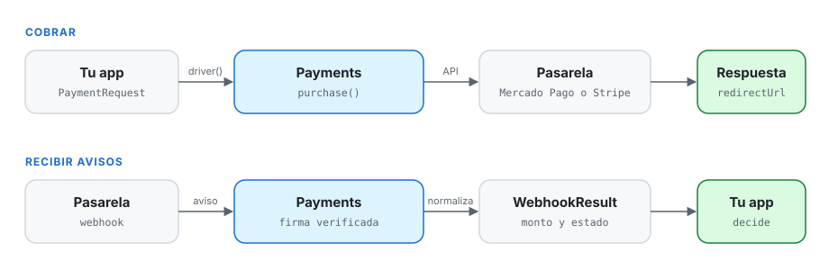

<p align="center">
  <picture>
    <source media="(prefers-color-scheme: dark)" srcset=".github/assets/logo-dark.svg">
    
  </picture>
</p>

<h3 align="center">Mercado Pago and Stripe in Laravel, behind one interface</h3>

<p align="center">
  <a href="https://packagist.org/packages/abitechdev/payments-laravel"></a>
  <a href="https://packagist.org/packages/abitechdev/payments-laravel"></a>
  <a href="https://github.com/abitech-dev/abitech-payments-laravel/actions/workflows/ci.yml"></a>
  
  
  <a href="LICENSE"></a>
</p>

<p align="center">
  <a href="#quick-start">Quick start</a> &nbsp;|&nbsp;
  <a href="#available-drivers">Drivers</a> &nbsp;|&nbsp;
  <a href="#webhooks">Webhooks</a> &nbsp;|&nbsp;
  <a href="#environment-variables">Variables</a> &nbsp;|&nbsp;
  <a href="#in-your-tests">In your tests</a> &nbsp;|&nbsp;
  <a href="README.md">Español</a>
</p>

<br>

Charge, refund, subscribe and receive notifications from **Mercado Pago** and
**Stripe** with the same code. Your app builds a `PaymentRequest`, picks the
driver and gets a normalized response back. The package talks to the gateway,
verifies its webhook signatures and returns the same DTOs for both. Your app
stores, deduplicates and decides.

<p align="center">
  <picture>
    <source media="(prefers-color-scheme: dark)" srcset=".github/assets/flujo-dark.svg">
    
  </picture>
</p>

## Quick start

**1. Install the package.** Laravel registers it automatically.

```bash
composer require abitechdev/payments-laravel
```

**2. Add the credentials** of your gateway to `.env`.

```env
ABITECH_PAYMENTS_DEFAULT=mercadopago_checkout
MERCADOPAGO_ACCESS_TOKEN=APP_USR-...
```

**3. Charge** with the driver you choose.

```php
use Abitech\Payments\DTO\PaymentRequest;
use Abitech\Payments\Facades\Payment;

$response = Payment::driver('mercadopago_checkout')->purchase(new PaymentRequest(
    amount: '100.00',
    currency: 'PEN',
    email: 'customer@email.com',
    description: 'Monthly subscription',
    idempotencyKey: request()->header('X-Idempotency-Key'),
    metadata: [
        'success_url' => route('billing.success'),
        'cancel_url' => route('billing.cancel'),
    ],
));

return redirect($response->redirectUrl);
```

## Features

<table>
  <tr>
    <td width="50%" valign="top">
      <h4>🔌 One interface, two gateways</h4>
      Mercado Pago and Stripe answer with the same DTOs. Switching gateways
      means switching the driver slug.
    </td>
    <td width="50%" valign="top">
      <h4>🔐 Verified webhook signatures</h4>
      With the gateway secret configured, every notification is checked
      before it reaches your app and is normalized into a
      <code>WebhookResult</code>.
    </td>
  </tr>
  <tr>
    <td valign="top">
      <h4>🔁 Full subscriptions</h4>
      Create, change the amount, cancel and list the charges of each
      subscription.
    </td>
    <td valign="top">
      <h4>💵 Exact amounts</h4>
      Amounts travel as decimal strings and are computed with
      <code>bcmath</code>, never with <code>float</code>.
    </td>
  </tr>
  <tr>
    <td valign="top">
      <h4>🛟 Retries and idempotency</h4>
      Retries transient errors with growing backoff, caps requests per
      minute and prevents double charges with the idempotency key.
    </td>
    <td valign="top">
      <h4>🧪 Fake driver for tests</h4>
      <code>FakePaymentDriver</code> covers charges, subscriptions and
      webhooks without the network. The package has 276 tests.
    </td>
  </tr>
</table>

## Available drivers

| Driver | Slug | Type |
| --- | --- | --- |
|  Checkout Pro | `mercadopago_checkout` | Redirects to the gateway |
|  API (Bricks) | `mercadopago_api` | Direct charge |
|  Checkout | `stripe_checkout` | Redirects to the gateway |
|  PaymentIntents | `stripe_paymentintents` | Direct charge |
| 🧪 Tests | `fake` | No network |

## Requirements

| Component | Version |
| --- | --- |
| PHP | 8.2 or later, with `bcmath`. Laravel 13 needs 8.3 |
| Laravel | 12.69 or later, or 13.30 or later |
| Mercado Pago | `mercadopago/dx-php` 3.0.5 or later ([SDK](docs/mercadopago.md)) |
| Stripe | `stripe/stripe-php` 17 to 22 ([SDK](docs/stripe.md#sdk)) |

Install only the SDK of the gateway you use.

## Webhooks

Define one endpoint per gateway and hand the request to the driver. With
`*_WEBHOOK_SECRET` configured, the package verifies the signature and throws
`PaymentGatewayException` when it is not valid. Always set it in production.

```php
use Abitech\Payments\Exceptions\PaymentGatewayException;
use Abitech\Payments\Facades\Payment;
use Illuminate\Http\Request;

Route::post('/webhooks/{gateway}', function (Request $request, string $gateway) {
    try {
        $result = Payment::driver($gateway)->handleWebhook($request);
    } catch (PaymentGatewayException $e) {
        return response()->noContent(400);
    }

    // Your app stores the notification, deduplicates and updates the payment.
    return response()->noContent();
});
```

Store the raw payload before processing it. The
[integration guide](docs/host-integration.md), in Spanish, shows the
notification log and the events your app can dispatch.

## Environment variables

```env
# General
ABITECH_PAYMENTS_DEFAULT=mercadopago_checkout
ABITECH_PAYMENTS_KEY_TYPE=uuid
ABITECH_PAYMENTS_DB_CONNECTION=null

# Mercado Pago
MERCADOPAGO_PUBLIC_KEY=
MERCADOPAGO_ACCESS_TOKEN=
MERCADOPAGO_CLIENT_ID=
MERCADOPAGO_CLIENT_SECRET=
MERCADOPAGO_WEBHOOK_SECRET=

# Stripe
STRIPE_KEY=
STRIPE_SECRET=
STRIPE_WEBHOOK_SECRET=
```

To change retries, the rate limit or idempotency, publish the configuration.
The migrations create the base tables the host uses.

```bash
php artisan vendor:publish --tag=abitech-payments-config
php artisan vendor:publish --tag=abitech-payments-migrations
```

<details>
<summary><strong>Amounts and currencies</strong></summary>
<br>

Amounts are decimal strings in the major unit (`'19.99'`), never `float`, in
the DTOs, in `refund()` and in `WebhookResult::$amount`. An amount in another
format, or with more decimals than the currency allows in Stripe, throws
`PaymentGatewayException` 422. `WebhookResult::$currency` is the uppercase ISO
4217 code (`'PEN'`) for every gateway.

</details>

<details>
<summary><strong>Several accounts of the same gateway</strong></summary>
<br>

In an app with several customers, each with its own account, ask for the
driver of a given customer. Its credentials come from the resolver you
register.

```php
Payment::forTenant($customerId)->driver('stripe_checkout')->purchase($order);
```

</details>

## In your tests

Use the `fake` driver to test charges, subscriptions and webhooks without
credentials or network.

```php
$response = Payment::driver('fake')->purchase($order);
```

## More

- 📚 Guides, in Spanish: [integration in your app](docs/host-integration.md),
  [architecture](docs/architecture.md) and [migrations](docs/migrations.md).
- 💳 References: [Mercado Pago](docs/mercadopago.md) and [Stripe](docs/stripe.md).
- 🔒 [Security policy](SECURITY.md). Vulnerabilities are reported privately.
- 🤝 [Contributing guide](CONTRIBUTING.md). Proposals are welcome.
- 📝 [Changes in each version](CHANGELOG.md).

## License

Released under the [MIT license](LICENSE). You can use, modify and
distribute it, commercial projects included.

<br>

<p align="center">
  Made in Huánuco, Peru, by <a href="https://abitech.dev">Abimael Fernandez</a>
</p>
