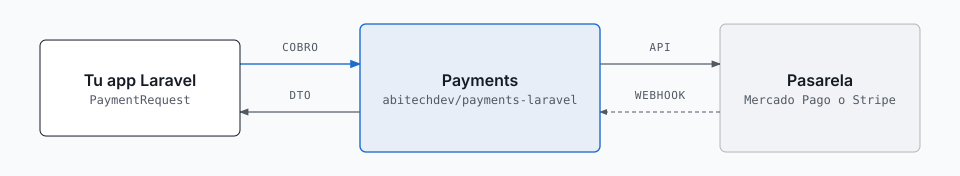

<p align="center">
  <picture>
    <source media="(prefers-color-scheme: dark)" srcset="docs/imagenes/logo-oscuro.svg">
    
  </picture>
</p>

<h1 align="center">Payments Laravel</h1>

<p align="center">Cobra, reembolsa, suscribe y recibe webhooks de Mercado Pago y Stripe en Laravel con una sola interfaz</p>

<p align="center">
  <a href="https://packagist.org/packages/abitechdev/payments-laravel"></a>
  <a href="https://github.com/abitech-dev/abitech-payments-laravel/actions/workflows/ci.yml"></a>
  
  <a href="LICENSE"></a>
</p>

<p align="center">
  <a href="#inicio-rápido">Inicio rápido</a> &nbsp;|&nbsp;
  <a href="#uso">Uso</a> &nbsp;|&nbsp;
  <a href="#documentación">Documentación</a> &nbsp;|&nbsp;
  <a href="README.en.md">English</a>
</p>

<picture>
  <source media="(prefers-color-scheme: dark)" srcset="docs/diagramas/flujo-dark.svg">
  
</picture>

Tu app arma un `PaymentRequest`, elige el driver y recibe una respuesta igual
para Mercado Pago y Stripe. El paquete habla con la pasarela y verifica sus
webhooks; tu app guarda, deduplica y decide.

## Qué resuelve

<table>
  <tr>
    <td width="50%" valign="top">
      <picture><source media="(prefers-color-scheme: dark)" srcset="docs/iconos/pasarelas-dark.svg"></picture><br><strong>Una interfaz, dos pasarelas</strong><br>Mercado Pago y Stripe responden con los mismos DTO; cambiar de pasarela es cambiar el driver.
    </td>
    <td width="50%" valign="top">
      <picture><source media="(prefers-color-scheme: dark)" srcset="docs/iconos/webhook-dark.svg"></picture><br><strong>Webhooks verificados</strong><br>Con el secreto configurado, cada aviso se valida y llega como un <code>WebhookResult</code>.
    </td>
  </tr>
  <tr>
    <td width="50%" valign="top">
      <picture><source media="(prefers-color-scheme: dark)" srcset="docs/iconos/suscripciones-dark.svg"></picture><br><strong>Suscripciones completas</strong><br>Alta, cambio de monto, cancelación y la lista de cobros de cada suscripción.
    </td>
    <td width="50%" valign="top">
      <picture><source media="(prefers-color-scheme: dark)" srcset="docs/iconos/montos-dark.svg"></picture><br><strong>Montos exactos</strong><br>Cadenas decimales calculadas con <code>bcmath</code>, nunca con <code>float</code>.
    </td>
  </tr>
  <tr>
    <td width="50%" valign="top">
      <picture><source media="(prefers-color-scheme: dark)" srcset="docs/iconos/idempotencia-dark.svg"></picture><br><strong>Sin cobros dobles</strong><br>Reintentos con espera creciente, límite por minuto y clave de idempotencia.
    </td>
    <td width="50%" valign="top">
      <picture><source media="(prefers-color-scheme: dark)" srcset="docs/iconos/pruebas-dark.svg"></picture><br><strong>Pruebas sin red</strong><br><code>FakePaymentDriver</code> cubre cobros, suscripciones y webhooks sin salir a internet.
    </td>
  </tr>
</table>

## Inicio rápido

```bash
composer require abitechdev/payments-laravel
```

```env
ABITECH_PAYMENTS_DEFAULT=mercadopago_checkout
MERCADOPAGO_ACCESS_TOKEN=APP_USR-...
```

```php
use Abitech\Payments\DTO\PaymentRequest;
use Abitech\Payments\Facades\Payment;

$respuesta = Payment::driver('mercadopago_checkout')->purchase(new PaymentRequest(
    amount: '100.00',
    currency: 'PEN',
    email: 'cliente@email.com',
    description: 'Suscripción mensual',
    idempotencyKey: request()->header('X-Idempotency-Key'),
    metadata: ['success_url' => route('billing.success'), 'cancel_url' => route('billing.cancel')],
));

return redirect($respuesta->redirectUrl);
```

La persona paga en Mercado Pago y vuelve a `success_url`. Las demás variables,
la configuración desde base de datos y el uso con varios clientes están en la
[guía de integración](docs/host-integration.md).

## Uso

| Driver | Slug | Tipo |
| --- | --- | --- |
| Mercado Pago Checkout Pro | `mercadopago_checkout` | Redirige a la pasarela |
| Mercado Pago API (Bricks) | `mercadopago_api` | Cobro directo |
| Stripe Checkout | `stripe_checkout` | Redirige a la pasarela |
| Stripe PaymentIntents | `stripe_paymentintents` | Cobro directo |
| Pruebas | `fake` | Sin red |

Un endpoint por pasarela recibe los avisos. Con el `*_WEBHOOK_SECRET`
configurado, una firma inválida lanza `PaymentGatewayException`:

```php
use Abitech\Payments\Exceptions\PaymentGatewayException;
use Abitech\Payments\Facades\Payment;
use Illuminate\Http\Request;

Route::post('/webhooks/{gateway}', function (Request $request, string $gateway) {
    try {
        $resultado = Payment::driver($gateway)->handleWebhook($request);
    } catch (PaymentGatewayException $e) {
        return response()->noContent(400);
    }

    return response()->noContent();
});
```

## Compatibilidad

| Herramienta | Versión |
| --- | --- |
| PHP | 8.2 o superior, con `bcmath`; 8.3 con Laravel 13 |
| Laravel | 12.69 o superior, o 13.30 o superior |
| Mercado Pago | `mercadopago/dx-php` 3.0.5 o superior |
| Stripe | `stripe/stripe-php` de la 17 a la 22 |

Solo se instala el SDK de la pasarela que se usa.

## Documentación

| Quiero… | Documento |
| --- | --- |
| Integrarlo en mi app | [host-integration.md](docs/host-integration.md) |
| Usar Mercado Pago | [mercadopago.md](docs/mercadopago.md) |
| Usar Stripe | [stripe.md](docs/stripe.md) |
| Publicar y adaptar las tablas | [migrations.md](docs/migrations.md) |
| Entender cómo está hecho | [architecture.md](docs/architecture.md) |
| Saber por qué se publica así | [ADR 0001](docs/decisiones/0001-ramas-y-publicacion.md) |
| Ver los cambios por versión | [CHANGELOG.md](CHANGELOG.md) |

## Contribuir

Los pasos y lo que revisa la integración continua están en
[CONTRIBUTING.md](CONTRIBUTING.md). Para reportar una vulnerabilidad, sigue
[SECURITY.md](SECURITY.md).

## Licencia

Copyright © 2026 ABItech Perú. Licencia MIT, cuyo texto figura en
[LICENSE](LICENSE).
